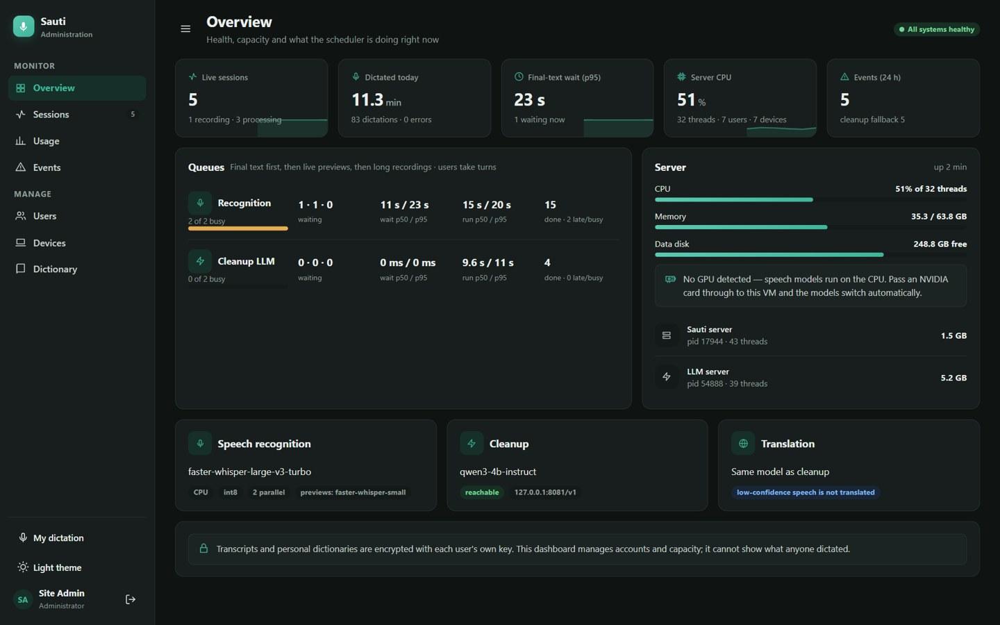
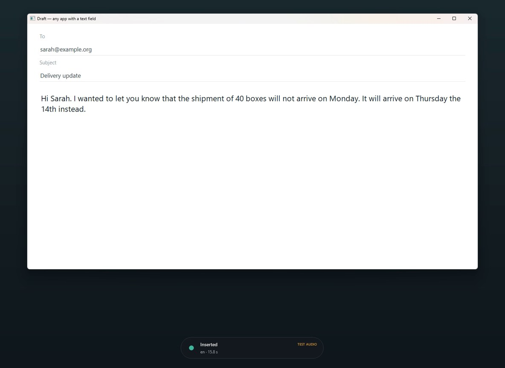
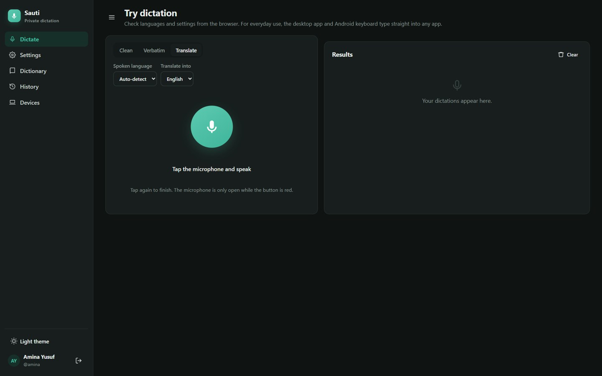
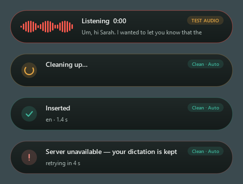
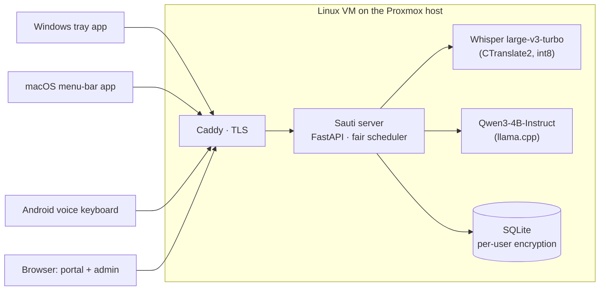

<p align="center"></p>

<h1 align="center">Sauti — private AI dictation on your own server</h1>

<p align="center">
Speak into any app on Windows, macOS or Android and get polished text back where your cursor is.<br>
Speech recognition, cleanup and translation run on <b>your</b> hardware: no cloud AI, no per-minute fees.
</p>

<p align="center">
<a href="#demo">Demo</a> · <a href="docs/architecture.md">Architecture</a> · <a href="docs/models.md">Models</a> ·
<a href="docs/benchmarks.md">Benchmarks</a> · <a href="docs/deployment.md">Deploy</a> · <a href="docs/privacy-security.md">Privacy</a>
</p>

---

Sauti ("voice" in Swahili) is a self-hosted alternative to tools like Wispr Flow, built for an
organisation that dictates in **English, Somali, Arabic and Swahili** and must keep every word
on its own Proxmox server.

* **System-wide dictation.** A tray / menu-bar app for Windows and macOS (hold a key, speak,
  release — the text appears where your cursor is) and an Android voice keyboard that works in
  WhatsApp, Gmail and any other app.
* **Three modes.** Verbatim transcription; clean dictation (hesitations, repetitions and
  punctuation fixed, meaning preserved); and translation into a chosen language. Automatic or
  manual language selection.
* **Meaning-preservation guard.** The cleanup LLM's output is checked against what was said.
  If a name, number, date, negation or dictionary term changed — or the text was summarised,
  answered or padded — Sauti discards it and returns a safe rule-based cleanup instead.
* **Built for a shared CPU server.** A fair scheduler with priorities, bounded queues,
  deadlines and cancellation keeps dictation responsive for several people at once, and
  degrades gracefully (live previews go first) when the machine is busy.
* **No lost or duplicated text.** Audio is kept on the device until the result arrives;
  dropped connections resume automatically, and every dictation is inserted exactly once.
* **Multi-user with real privacy.** Accounts, multiple devices per user, synced settings and
  personal dictionaries, an organisation dictionary, optional transcript history with
  deletion controls. Personal data is encrypted with each user's own key — administrators
  manage accounts and capacity but cannot read what anyone dictated.
* **Admin dashboard.** Users, devices, live sessions, usage limits, queue and server health,
  failure log, audit log.
* **Replaceable models.** Recogniser, cleanup model and translator are configuration on the
  server. Upgrading a model never requires a new client release.
* **CPU today, GPU-ready.** Runs CPU-only; with an NVIDIA card passed through to the VM, speech
  models switch to the GPU automatically (`GPU=1 ./deploy/install.sh`, `sauti-server doctor`).

## Demo

<table>
<tr>
<td colspan="2"></td>
</tr>
<tr>
<td colspan="2"><sub>Admin overview while five simulated users dictate on a CPU-only workstation: live sessions, fair queues with wait and run times, server meters (GPU meters appear when a card is present), model status. No dictated text is visible to administrators.</sub></td>
</tr>
<tr>
<td width="52%"></td>
<td></td>
</tr>
<tr>
<td><sub>Spoken: <i>"Um, hi Sarah. I wanted to let you know that the, uh, the shipment of forty boxes will not arrive on Monday. It will, um, arrive on Thursday the fourteenth instead."</i> — inserted after clean-up (recorded before the status-pill redesign).</sub></td>
<td><sub>User portal: try dictation, settings that sync to every device, personal dictionary, encrypted history, phone pairing. Light and dark themes.</sub></td>
</tr>
<tr>
<td colspan="2" align="center"><br><sub>The desktop status pill: live waveform while the microphone is open, then processing, inserted, or a clear offline message.</sub></td>
</tr>
</table>

**Video:** [`docs/media/sauti-demo.mp4`](docs/media/sauti-demo.mp4) (about 2 minutes).

It shows the real Windows tray app dictating into an editor through the real server and models
on a CPU-only workstation, then the admin dashboard under a five-user load and the user portal.
Speech is played into the app's microphone path from audio files (the status pill says "TEST
AUDIO") so the run is reproducible, and every cut of processing time is labelled with the
seconds removed.

## How it fits together



Details: [docs/architecture.md](docs/architecture.md) · wire protocol: [docs/protocol.md](docs/protocol.md)

## Results at a glance

<!-- RESULTS-START -->
Measured on a CPU-only development workstation that was also running other heavy jobs —
conditions, raw data and estimates for the target server in [docs/benchmarks.md](docs/benchmarks.md).

| | Result |
|---|---|
| Recognition, Whisper large-v3-turbo (FLEURS word error rate) | English **4.6%** · Arabic **10.1%** · Swahili **35.3%** · Somali **95%** (not usable — needs a Somali model, routed per language) |
| Language detection | 100% for English, Arabic, Swahili · 0% for Somali (select Somali manually) |
| Cleanup (errors left vs. the original sentence) | English 2.7% → **1.2%** with the LLM; for Somali, Arabic, Swahili rules alone are as good → LLM used for English by default |
| Safety | The guard rejected the one dictated instruction the LLM obeyed; low-confidence speech is not translated (prevents invented translations) |
| Concurrency | **41/41** dictations completed at 1, 3 and 5 simultaneous users, no errors, no duplicates; fair queueing kept median queue wait < 4 s at 5 users |
| Latency on this busy CPU | Median 21 s (1 user) to 28 s (5 users) from release to final text — compute-bound. Estimated 4–7 s on a dedicated 9600X VM; a GPU is recommended for ~1 s |
<!-- RESULTS-END -->

## Repository layout

| Path | What |
|---|---|
| `server/` | Backend: REST + WebSocket API, scheduler, pipeline, model backends, admin dashboard and user portal (`sauti_server/web`). 61 tests. |
| `desktop/` | Windows / macOS tray app (PySide6). Network-client and Windows end-to-end tests. |
| `android/` | Android voice keyboard (Kotlin). Pure-Kotlin `core` protocol module with 49 tests (one runs against a live server); `app` module with the IME. |
| `bench/` | Accuracy, cleanup, translation, mixed-language and concurrent-user benchmarks. |
| `deploy/` | Proxmox VM script, installer, systemd units, Caddy config, backup and update scripts. |
| `docs/` | Architecture, protocol, models, benchmarks, deployment, user / admin guides, privacy, licences. |

## Quick start (development)

```bash
# Server with fake models (no downloads): http://127.0.0.1:8700/admin
cd server && pip install -e ".[dev]" && pytest -q
python ../scripts/dev_server.py deploy/dev-fake.toml      # from the repo root
python -c "import sys; sys.path.insert(0,'server'); from sauti_server.cli import main; main(['--config','deploy/dev-fake.toml','create-user','--admin','admin'])"

# Real models on a workstation
python scripts/download_models.py --dest ../models
llama-server -m ../models/gguf/Qwen3-4B-Instruct-2507-Q4_K_M.gguf --port 8081 -c 8192 --parallel 2
python scripts/dev_server.py deploy/dev.toml

# Desktop app from source
pip install -r desktop/requirements.txt && cd desktop && python -m sauti_desktop
```

Production install on Proxmox: [docs/deployment.md](docs/deployment.md).

## Builds

GitHub Actions builds the Windows app, the macOS app (Apple Silicon and Intel) and the
Android APK on every push (`.github/workflows/`). Tagged versions (`v*`) collect them into a
draft release.

## Status and known limitations

This repository is a working proof of concept (milestone 1 of the proposed plan):

* **Somali accuracy is the main open item.** Whisper's Somali output is not usable
  (measured word error rate around 95%) and Whisper's language detection does not recognise
  Somali. The server already routes a language to its own model; a Somali-capable recogniser
  (candidate: Meta Omnilingual ASR, Apache-2.0) must be validated on the client's recordings.
* Benchmarks here were measured on a development workstation, not the client's Ryzen 5
  9600X; the same scripts are meant to be re-run on the Proxmox host.
* The macOS app is built by CI but has not been tested on a Mac in this milestone; it needs
  code signing/notarisation for smooth installation.
* The Android APK is built by CI; it has not yet been tested on physical devices.
* Mixed-language speech within a single sentence is only partly handled by Whisper.

## Licence

Apache-2.0 for this code. Model and dependency licences: [docs/licences.md](docs/licences.md).
