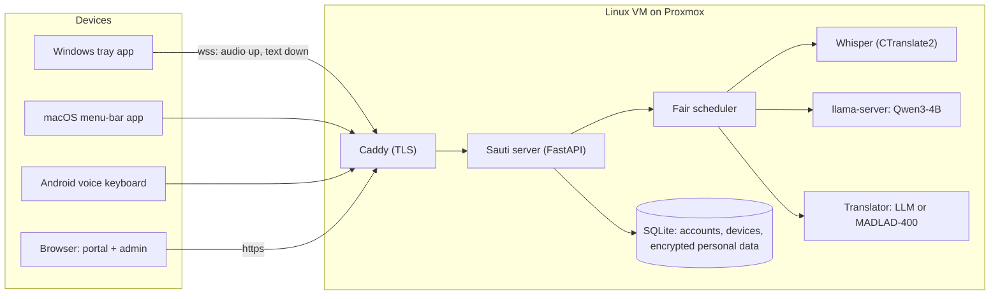

# Architecture

Sauti has three kinds of client and one server. All speech recognition, cleanup and
translation runs on the server, inside a Linux VM on the organisation's Proxmox host.
Clients never contain a model, so they stay small and work on low-end phones.

## Request path for one dictation

1. The user holds the dictation key (desktop) or taps the mic (Android). The client opens
   the microphone and streams 16 kHz PCM in 100 ms frames over the device's WebSocket.
2. While audio arrives, the server periodically sends a **live preview** made with a small,
   fast model. Previews are the lowest-priority work and are dropped first under load.
3. On release the client sends `end`. The server queues the **final** recognition job
   (highest priority), then:
   * replaces "sounds like" aliases with dictionary spellings,
   * runs rule-based cleanup (hesitations, stutters, spacing),
   * in *clean* mode, asks the LLM for a polished version and **checks it** with the
     meaning-preservation guard; if the check fails, the rule-based text is used,
   * in *translate* mode, translates the cleaned text and checks numbers and length.
4. The `final` message goes back to the device, which inserts the text into the active
   field and acknowledges it. Audio is discarded as soon as recognition is done.

## Components

| Part | Technology | Notes |
|---|---|---|
| Server | Python 3.11+, FastAPI, uvicorn | One process; REST + WebSocket. `server/sauti_server/` |
| Recogniser | faster-whisper (CTranslate2) | int8 on CPU, float16 on GPU. Backend interface in `backends/base.py` |
| Cleanup / translation LLM | llama.cpp `llama-server` (OpenAI-compatible) | Any OpenAI-compatible local server works (vLLM, Ollama) |
| Dedicated translator | CTranslate2 + MADLAD-400 3B | Optional, `translate.backend = "ct2"` |
| Database | SQLite (WAL) | Single file; online backup via `sauti-server backup` |
| TLS / reverse proxy | Caddy | Internal CA on the LAN or Let's Encrypt for a public name |
| Desktop app | Python, PySide6 (Qt), pynput, sounddevice | Windows + macOS from one code base; PyInstaller builds |
| Android app | Kotlin, InputMethodService, OkHttp | Voice keyboard; protocol logic in a pure-Kotlin `core` module |
| Admin dashboard / portal | Static HTML + JS served by the server | No external scripts, fonts or analytics |

## Scheduling (why five people can share six cores)

`server/sauti_server/scheduler.py` runs one queue per kind of model work (`asr`, `llm`,
`translate`), each with a fixed number of workers.

* **Strict priority:** final text > live previews > long recordings. A long recording ages
  into the front after 10 s so it cannot starve.
* **Fair:** within a class, users take turns (round-robin), so one heavy user does not delay
  the others.
* **Bounded:** per-class and per-user queue limits. When full, the client receives `busy`
  with a retry hint instead of waiting indefinitely.
* **Deadlines and cancellation:** every job has a deadline; expired or cancelled jobs never
  start, and running recognition stops at the next segment.
* **Previews are "latest wins":** a newer preview replaces a queued one and stale previews
  are dropped.

## Reliability: no lost text, no duplicate text

Each dictation has a client-generated UUID. The client keeps the audio in memory until the
final arrives. After a dropped connection it reconnects and *resumes*; the server either
replays the stored result or asks for the audio again. The client records every inserted
UUID in a small ledger and never inserts the same one twice. Details and message formats:
[protocol.md](protocol.md). The desktop test suite restarts the server in the middle of a
dictation and checks the text still arrives exactly once (`desktop/tests/test_client.py`).

## Replaceable models

Model choice is configuration (`/etc/sauti/sauti.toml`), not code in the clients:

* `asr.model` — any CTranslate2 Whisper model (turbo, large-v3, a fine-tune).
* `asr.per_language` — route one language to a different model, e.g. a Somali recogniser.
* `asr.partial_model` — the cheap preview model.
* `llm.base_url` / `llm.model` — any OpenAI-compatible local server.
* `translate.backend` — `llm` or `ct2` (MADLAD-400 / NLLB).

A new backend type is one class implementing the small protocol in `backends/base.py`.
